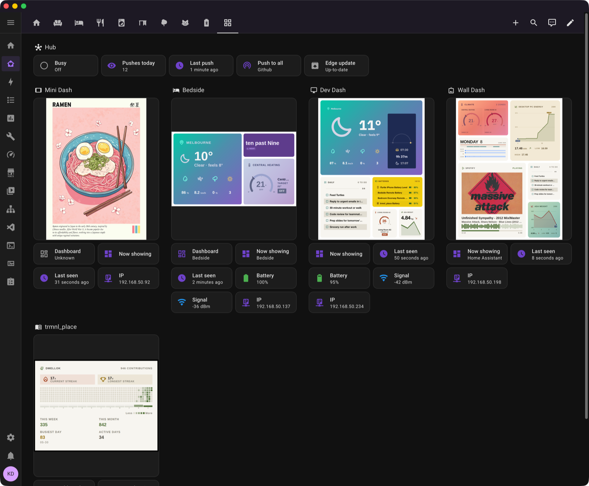
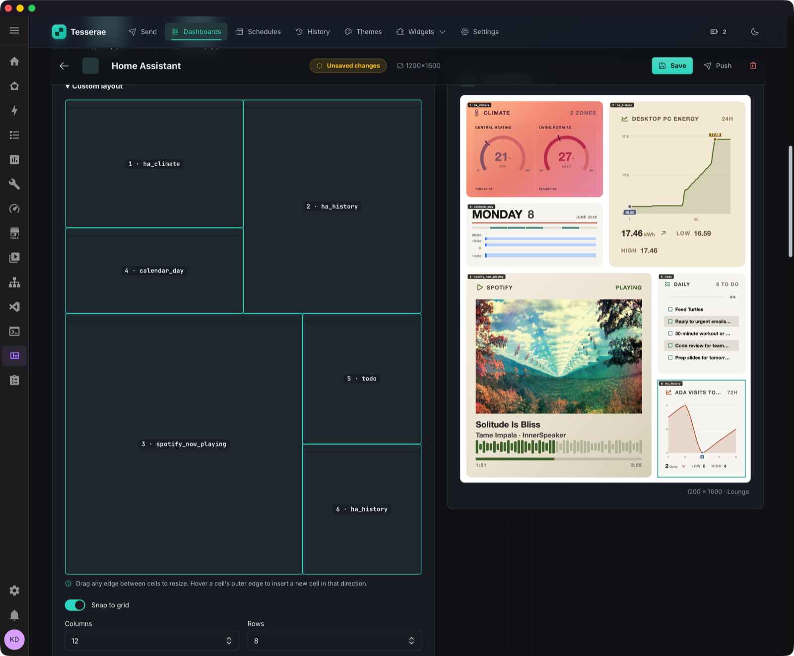
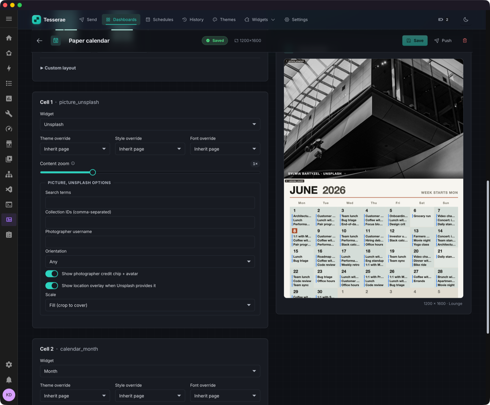
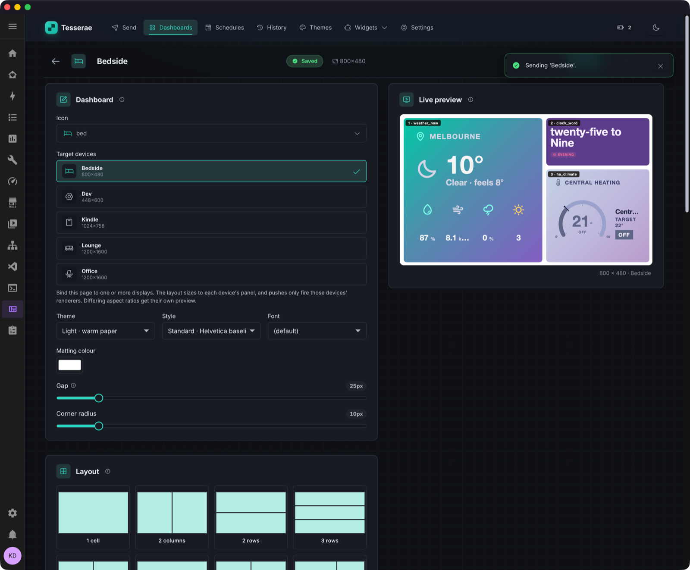
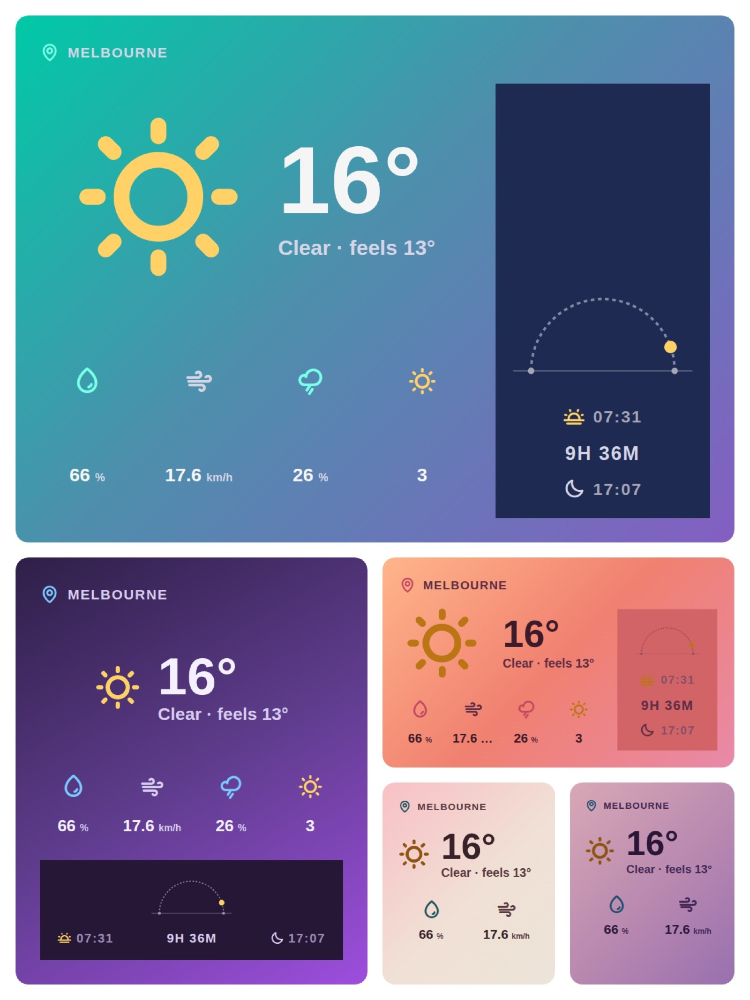

# Gallery

See home installations in the [README](https://github.com/dmellok/tesserae/blob/main/README.md#tesserae). Browse individual widgets in the [bundled widget gallery](widgets/gallery.md) or [community catalog](https://tesserae.ink/catalog/).

## Inside Home Assistant

Home Assistant shows a Hub tile and one card per screen.
Each card shows a live image, battery level, signal and IP address.

## Composing a dashboard

The tile grid is on the left. The live preview is on the right.

"Paper Calendar" pairs an edge-to-edge Unsplash photo with a month grid. It is drawn at 1200×1600 for an Inky 13.3".

Bedside dashboard with two of the gradient themes, mid-send.

## One widget, every cell size

{ width="600" }

The `weather_now_scenic` widget uses CSS container queries to rearrange content as its cell shrinks. One version fits all sizes.
