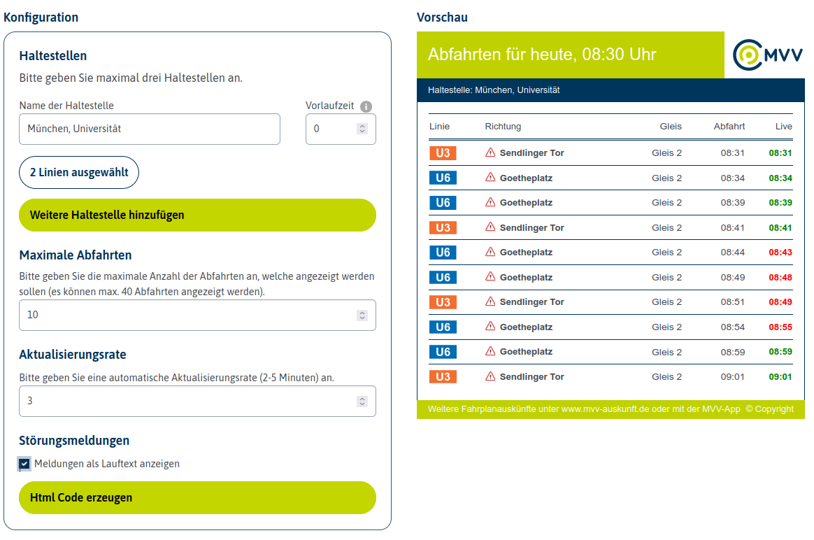
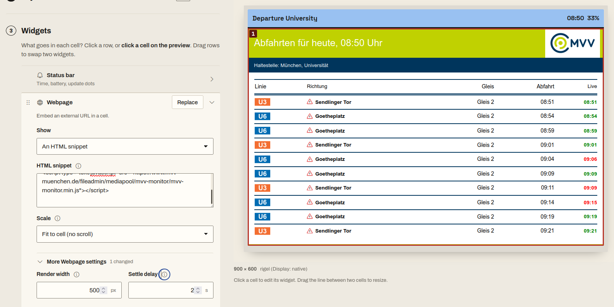

Create An Embedded Transit-Board with the Webpage-Widget
========================================================


Introduction
------------

Tesserae already has a few widgets that show departure times of
public transportation. A genuine widget needs an official API to
query the data.

Public transportation in Munich is organized by the "MVV" (Münchner
Verkehrsverbund) which currently *does not* offer an official public
API. Instead, they offer a toolkit to create a HTML snippet. This is
meant to be included in websites of e.g. local stores or companies as
a service for their customers or employees.

This howto demonstrates the necessary steps to use this toolkit for
Tesserae. It serves as a model for similar offerings.


Create the HTML-Snippet
-----------------------

The MVV toolkit is currently available at
<https://www.mvv-muenchen.de/service-hilfe/mvv-content-fuer-entwickler/baukasten-fuer-haltestellen-abfahrtsmonitore/>:



You basically select the station, select the lines and destinations and then
create the snippet with the button "Html Code erzeugen". Copy it for later use.

The snippet only contains two elements: a `<div>`-tag and a `<script>`-tag:

```
<div class="mvv-departure-monitor" monitor-configuration="eyJsYW5ndWFnZSI6eyJkZXBhcnR1cmUiOiJBYmZhaHJ0IiwidHJhaW5TdG9wcyI6IkhhbHRlc3RlbGxlbiIsImRpcmVjdGlvbiI6IlJpY2h0dW5nIiwiZm9vdGVyTm90ZSI6IqkgQ29weXJpZ2h0IiwiZm9vdGVyVGV4dCI6IldlaXRlcmUgRmFocnBsYW5hdXNr/G5mdGUgdW50ZXIgd3d3Lm12di1hdXNrdW5mdC5kZSBvZGVyIG1pdCBkZXIgTVZWLUFwcCIsImhlYWRlclRleHQiOiJBYmZhaHJ0ZW4gZvxyIGhldXRlLCAiLCJsYW5ndWFnZSI6ImRlIiwibGluZSI6IkxpbmllIiwibGl2ZSI6IkxpdmUiLCJzdG9wIjoiSGFsdGVzdGVsbGUiLCJ0cmFjayI6IkdsZWlzIn0sImlzRnVsbHNjcmVlbiI6ZmFsc2UsInN0YXRpb25zIjpbeyJzdGF0aW9uIjp7InVzYWdlIjoic2YiLCJ0eXBlIjoiYW55IiwibmFtZSI6Ik38bmNoZW4sIFVuaXZlcnNpdOR0Iiwic3RhdGVsZXNzIjoiOTEwMDAwNzAiLCJhbnlUeXBlIjoic3RvcCIsInNvcnQiOiIyIiwicXVhbGl0eSI6Ijk5MyIsImJlc3QiOiIxIiwib2JqZWN0IjoiVW5pdmVyc2l05HQiLCJtYWluTG9jIjoiTfxuY2hlbiIsIm1vZGVzIjoiMiw1IiwicmVmIjp7ImlkIjoiOTEwMDAwNzAiLCJnaWQiOiJkZTowOTE2Mjo3MCIsIm9tYyI6IjkxNjIwMDAiLCJwbGFjZUlEIjoiMSIsInBsYWNlIjoiTfxuY2hlbiIsImNvb3JkcyI6IjEyODkxNzEuMDAwMDAsNTg2ODIzNS4wMDAwMCJ9LCJpZCI6ImRlOjA5MTYyOjcwIn0sImxpbmVzIjpbeyJudW1iZXIiOiJVMyIsInN5bWJvbCI6IjAxMFUzLnN2ZyIsImRpcmVjdGlvbiI6IlNlbmRsaW5nZXIgVG9yIiwic3RhdGVsZXNzIjoic3dtOjAxMFUzOkc6SDowMTYiLCJuYW1lIjoiVS1CYWhuIn0seyJudW1iZXIiOiJVNiIsInN5bWJvbCI6IjAxMFU2LnN2ZyIsImRpcmVjdGlvbiI6IkdvZXRoZXBsYXR6Iiwic3RhdGVsZXNzIjoic3dtOjAxMFU2Okc6SDowMTYiLCJuYW1lIjoiVS1CYWhuIn1dLCJsZWFkVGltZU1pbnV0ZXMiOjB9XSwibGluZXMiOltdLCJtYXhSZXN1bHRzIjoxMCwiZmV0Y2hJbnRlcnZhbEluTWludXRlcyI6Mywic2hvd05vdGlmaWNhdGlvbiI6dHJ1ZX0="></div>
<script type="text/javascript" src="https://www.mvv-muenchen.de/fileadmin/mediapool/mvv-monitor/mvv-monitor.min.js"></script>
```

The `<div>`-tag encodes the configuration. You can see the plain text by running
`base64 -d <<< "eyJsYW5ndWFnZSI6..."`.


Create the Dashboard
--------------------

The second step is to create a suitable dashboard. In Tesseare, select
"Dashboards" -> "+ New Dashboard". Follow the wizard and create at
least one cell with the "Webpage" widget. This widget is available in
the "Utility" category.

In the configuration of the widget, change the "Show" drop-down to "An
HTML snippet" and copy the snippet you saved in the first step into
the "HTML snippet" text field:



There is only one additional field you need to change: "Render
width". This is the screen width that the headless chrome running from
Tesseare will use to download the content. Render width matters
because servers usually change the layout depending on the browser
screen size. In the case of the MVV transit board, a render width of
500px seems optimal.


Fine Tuning the Output
----------------------

In the screenshot above you can see that the banners take up a lot of
space. Since they don't provide any useful information they can be
removed with some HTML-tricks.

To remove the banners, add the following snippet to the end of the
text box:

```
<script>
window.onload = function() {
  document.getElementsByClassName("mvv-monitor-header")[0].style.display = "none";
  document.getElementsByClassName("mvv-monitor-footer")[0].style.display = "none";
  document.getElementsByClassName("mvv-monitor-subheader")[0].style.display = "none";
  document.getElementsByClassName("fake-load-bar")[0].style.display = "none";
  document.getElementsByClassName("mvv-monitor-load-bar")[0].style.display = "none";
};
</script>
```

This is an inline script that runs at load-time, queries the elements that
we want to remove and sets the display style. Note that this part is
specific to the MVV toolkit. If you create a webpage with a different
source, you have to query the elements that are specific for that source.


Create a Linup
--------------

Once done, you can create a lineup that automatically refreshes the dashboard.
The lineup interval should match or nearly match the departure schedule,
since it does not make a lot of sense to query the departure of a train
every minute that itself runs on an hourly schedule.
